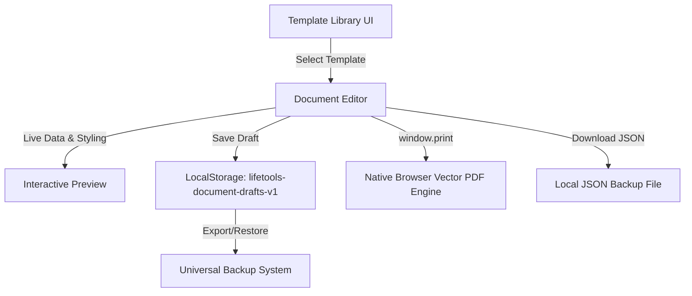

# LifeTools — Templates & Document Creator Guide

## Overview

The **Templates & Document Creator** is an offline-first, client-side document authoring studio built directly into LifeTools. It provides **40 professionally designed, fully customizable templates** spanning Business, Student, Personal, and Professional use cases.

Documents are designed to strictly comply with international paper standards (**A4 Portrait**, **A4 Landscape**, and **US Letter**), featuring real-time interactive previews, granular typography and color customization, local draft saving, editable JSON export/import, and zero-overflow `@media print` vector PDF rendering via the browser's native print engine.

---

## 40 Production-Ready Templates Catalog

### A. Business Templates (10)
1. **Invoice Generator (`invoice-generator`)**: Commercial tax invoice with customizable tax rates, discounts, itemized line items, banking details, and automated subtotal/grand total computations.
2. **Quotation Generator (`quotation-generator`)**: Sales quotation & price estimate with validity dates, line items, and terms of service.
3. **Receipt Generator (`receipt-generator`)**: Official payment acknowledgment receipt with payment method, transaction/cheque reference numbers, and received-from details.
4. **Purchase Order Generator (`purchase-order-generator`)**: Commercial PO authorizing procurement, shipping addresses, vendor codes, and payment milestones.
5. **Business Letter Generator (`business-letter-generator`)**: Formal executive correspondence with corporate sender/recipient blocks, reference lines, subject headers, and signature zones.
6. **Payment Voucher (`payment-voucher-generator`)**: Internal disbursement voucher with account debiting, receiver signatures, and authorized verification.
7. **Delivery Challan (`delivery-challan-generator`)**: Shipping and dispatch dispatch receipt recording vehicle numbers, carrier details, and dispatch packages.
8. **Business Card Maker (`business-card-maker`)**: High-contrast, printable 3.5×2-inch business cards featuring bilingual typography (English + Urdu: حازم بشیر), contact points, and QR positioning.
9. **Price List Generator (`price-list-generator`)**: Categorized commercial catalog sheet showcasing retail pricing, wholesale tiers, and currency symbols.
10. **Product Catalogue Generator (`product-catalogue-generator`)**: Multi-item inventory showcase with specifications, unit prices, SKU numbers, and branding notes.

### B. Student Templates (10)
1. **Resume Builder (`resume-builder`)**: Single-page modern engineering resume featuring professional summaries, core proficiencies, work experience, education, and portfolio links.
2. **Cover Letter Generator (`cover-letter-generator`)**: Focused job application letter aligned with targeted role descriptions, hiring manager titles, and applicant qualifications.
3. **Assignment Cover Page (`assignment-cover-page`)**: University and college course title page detailing subject codes, instructor titles, student roll numbers, and submission dates.
4. **Project Report Cover (`project-report-cover`)**: Academic capstone and research report binder cover with institutional headings, academic degrees, and department crests.
5. **Study Timetable (`study-timetable-template`)**: Structured 7-day weekly study schedule balancing deep-work revision blocks, breaks, and subject goals.
6. **Class Timetable (`class-timetable-template`)**: Daily period-by-period class timetable organizing lecture halls, professors, and weekday schedules.
7. **Attendance Sheet (`attendance-sheet-template`)**: Classroom roll call and laboratory roster tracking student attendance, present counts, and threshold percentages.
8. **Study Notes Template (`study-notes-template`)**: Cornell note-taking layout dividing page space into cue keywords, comprehensive lecture notes, and bottom summary takeaways.
9. **Certificate Template (`certificate-template`)**: Formal Certificate of Completion or Achievement in landscape format with gold accents, student citations, and signatory blocks.
10. **Exam Preparation Planner (`exam-preparation-planner`)**: High-stakes exam revision planner with chapter breakdowns, difficulty ratings, and mock score tracking.

### C. Personal Templates (10)
1. **Daily Planner (`daily-planner-template`)**: Hourly time-blocking day planner with priority focus tasks, schedule checklist, and daily reflections.
2. **Weekly Planner (`weekly-planner-template`)**: 7-day week overview setting key weekly milestones, habits, and daily priorities.
3. **Monthly Planner (`monthly-planner-template`)**: High-level 4-week calendar overview tracking monthly goals, key deadlines, and habit benchmarks.
4. **Personal Budget Sheet (`personal-budget-sheet`)**: Zero-based monthly cash flow sheet detailing fixed costs, discretionary spending, savings goals, and net surplus.
5. **Grocery List (`grocery-list-template`)**: Categorized grocery shopping guide organizing fresh produce, dairy, bakery, and pantry staples.
6. **Shopping List (`shopping-list-template`)**: General retail and household shopping list with budget estimates, priority flags, and store locations.
7. **Travel Planner (`travel-planner-template`)**: Day-by-day travel itinerary organizing accommodation details, flights, daily excursions, and emergency contacts.
8. **Packing Checklist (`packing-checklist-template`)**: Travel packing checklist categorized into essential travel documents, clothing, electronics, toiletries, and medication.
9. **Habit Tracker Sheet (`habit-tracker-sheet`)**: Printable 30-day habit adherence grid tracking consistency across fitness, reading, coding, and wellness routines.
10. **Goal Planning Sheet (`goal-planning-sheet`)**: S.M.A.R.T goal roadmap defining metrics, target dates, potential obstacles, and tangible action steps.

### D. Professional Documents (10)
1. **Professional Email Generator (`professional-email-generator`)**: High-impact corporate email drafts covering introductions, status updates, client follow-ups, and meeting invitations.
2. **Resignation Letter Generator (`resignation-letter-generator`)**: Respectful and formal notice of resignation outlining notice periods, handover commitments, and expressions of gratitude.
3. **Leave Application Generator (`leave-application-generator`)**: Formal workplace leave request specifying leave categories (sick, annual, casual), duration, and coverage plans.
4. **Experience Letter Template (`experience-letter-template`)**: Corporate service certification affirming job titles, tenure dates, technical contributions, and conduct.
5. **Internship Application (`internship-application-template`)**: Structured letter expressing interest in student internships, co-op terms, or apprenticeships.
6. **Meeting Agenda (`meeting-agenda-template`)**: Structured team meeting outline listing meeting objectives, discussion topics, time allocations, and presenters.
7. **Meeting Minutes (`meeting-minutes-template`)**: Official record of meeting proceedings capturing attendees, key discussions, decisions made, and assigned action items.
8. **Project Proposal (`project-proposal-template`)**: Comprehensive project pitch covering problem statements, proposed architectures, project phases, and estimated timelines.
9. **Work Report (`work-report-template`)**: Weekly or monthly executive progress report summarizing key deliverables, in-progress tasks, and blockers.
10. **Recommendation Letter (`recommendation-letter-template`)**: Formal character and academic recommendation detailing candidate strengths, achievements, and Dean/Manager endorsement.

---

## Architecture & Data Flow

### Key Technical Characteristics
1. **Zero External Dependencies / Zero Server Communication**:
   All template manipulation, styling calculations, and drafts management run strictly in the user's browser. No private documents or financial details are ever transmitted over the network.
2. **Print Isolation with `@media print`**:
   The application isolates `#printable-document-content` via custom CSS media rules, enforcing `@page { size: auto; margin: 10mm; }` to guarantee zero page clipping and pixel-perfect PDF export.
3. **Universal Backup & Restore Integration**:
   Saved document drafts are automatically incorporated into the LifeTools Universal Backup & Restore engine (`lifetools-document-drafts-v1`), supporting full JSON/ZIP export and cryptographic password protection.
